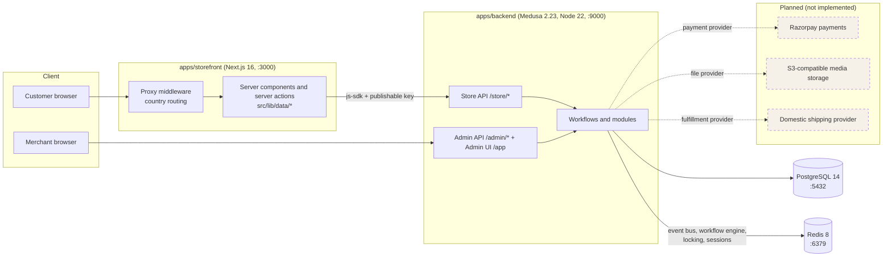

# Architecture

Lush Candles is a headless commerce monorepo: a Next.js storefront in front of
a Medusa v2 backend. Medusa is the single source of truth for catalogue,
pricing, inventory, carts, customers and orders. The storefront holds no
business logic of its own beyond presentation and input validation.

## Components

| Component | Status | Notes |
|---|---|---|
| Bun workspaces + Turborepo | Implemented | `bun.lock`; Turbo runs per-app tasks. |
| Next.js storefront | Implemented | Medusa DTC starter, rebranded; App Router, Tailwind, `@medusajs/ui`. |
| Medusa backend + Admin | Implemented | Runs on **Node.js**, not the Bun runtime. Bun is only the package manager and script runner. |
| PostgreSQL | Implemented | Homebrew `postgresql@14` locally. |
| Redis | Implemented | Event bus, workflow engine, locking and session store. |
| Redis caching module | Not enabled | Requires the `MEDUSA_FF_CACHING` feature flag in Medusa 2.23. Revisit when it is stable. |
| Razorpay | Planned | Needs credentials and a provider package. See the backlog in the README. |
| S3 media | Planned | `@medusajs/file-s3` is already installed and only needs configuration. |
| Shipping provider | Planned | Currently one manual shipping option with a placeholder rate. |

## Key decisions

- **Starter kept, not rewritten.** The Medusa DTC starter already covers
  listing, PDP, cart, checkout, account and order flows against supported
  Medusa APIs. Work focuses on branding, India defaults and hardening.
- **No shadcn/ui or Lucide yet.** The starter is built on `@medusajs/ui` and
  `@medusajs/icons`. Adding a second component system would duplicate
  primitives. Introduce shadcn/ui only for components `@medusajs/ui` lacks.
- **No `packages/*` yet.** Nothing is shared between the apps today, so the
  workspace only lists `apps/*`. Add `packages/<name>` when real shared code
  appears.
- **Commerce mutations go through core-flows workflows**, both in
  backend scripts (see `apps/backend/src/scripts/setup-india-market.ts`) and
  via the Store API from the storefront.
